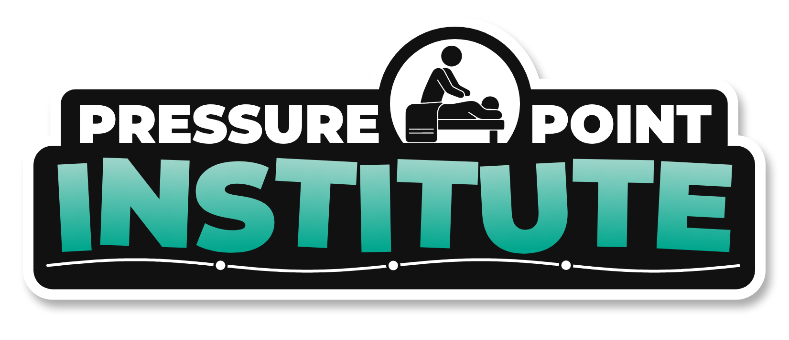
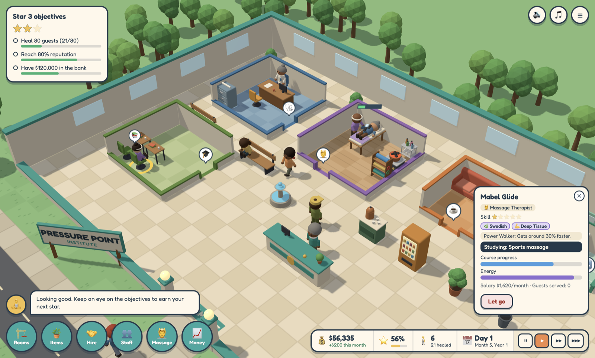
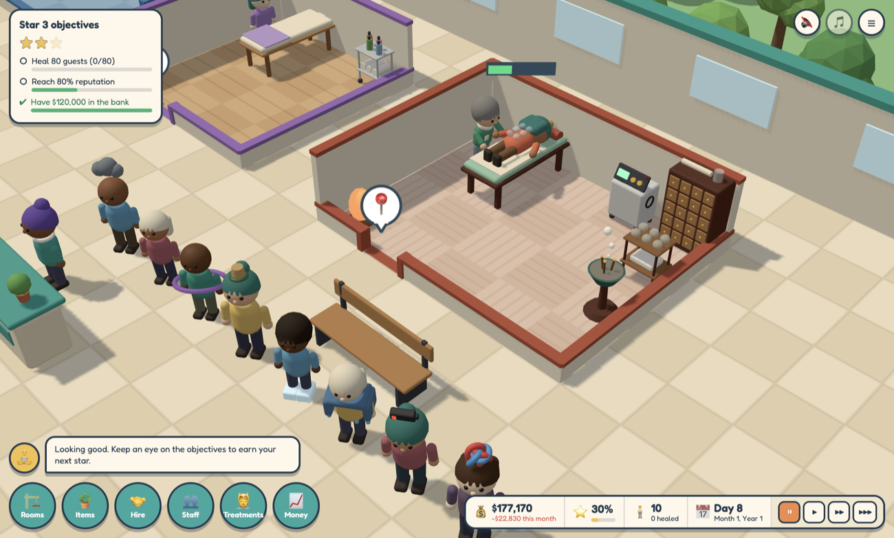
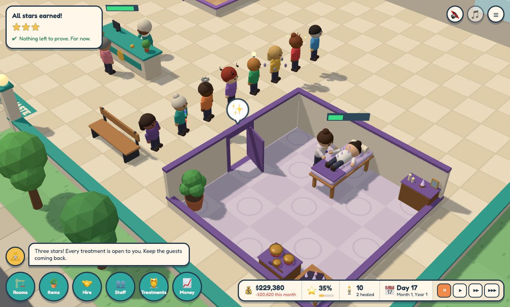

<h1 align="center"></h1>

<b><a href="https://maxcwolf.github.io/pressure-point/">▶ Play it now in your browser</a></b> or download it for <a href="https://github.com/maxcwolf/pressure-point/releases/latest">macOS or Windows</a>

A healing-center management sim, in the spirit of the classic hospital tycoon games. Build treatment rooms, hire therapists, and keep your guests happy enough to come back.

**Massage therapy**, **acupuncture** and **reiki** are open for business.

## Download

The [latest release](https://github.com/maxcwolf/pressure-point/releases/latest) has:

- `mac-arm64.dmg` for Macs with Apple silicon (M1 and later)
- `mac-x64.dmg` for Intel Macs
- `win-x64.exe` for Windows

The apps are not signed yet, so your computer will ask before opening one the first time. On macOS, right-click the app and choose **Open**. On Windows, click **More info**, then **Run anyway**.

The browser version needs nothing installed and is always the same version as the latest release.

## Campaign and sandbox

**Campaign** takes you through a series of centers, each with its own building, guests, goals and quirks. Earn a center's first star to open the next:

1. **Willow Lane**, a small high-street unit. Massage only: the place to learn the ropes.
2. **The Exchange**, downtown. Office workers with office ailments, arriving in rush hours when the office crowd comes in. Acupuncture opens here.
3. **Saltmarsh**, a seaside town. Packed in summer and quiet in winter, with seaside ailments and sea air that is hard on equipment. Reiki opens here.

Every campaign star earns **✨ karma**, and so do eight one-off **achievements**, like seeing an emergency through or healing 100 guests in one center. Spend karma in the **karma shop** (under Campaign on the title screen) or on a locked card in the Items menu. Each purchase stays unlocked in every center and the sandbox. Karma unlocks comfort and decor items early, before their star comes round, and three you can only get with karma: a **Massage Chair** that keeps a waiting guest patient, a **Bonsai** and a **Koi Pond**. The whole campaign earns enough karma to unlock all of them.

**Sandbox** is a big lot of your own, with no deadline. Choose the starting money, which treatments to offer, and whether everything is unlocked from day one.

## How to play

1. Place a **Reception Desk** and hire a **Receptionist**.
2. Build a **Consultation Room** (drag the floor, click a wall for the door, place the furniture) and hire a **Wellness Consultant**.
3. Build a **Massage Suite** and hire a **Massage Therapist**. The center opens once all three exist.
4. Guests check in, get diagnosed, get treated, and pay. Keep them patient with benches, tea, snacks, plants and a restroom, and as you earn stars, an arcade, an aquarium and more.
5. Staff members get tired. A **Staff Room** lets them recover; a **Janitor** clears litter, cleans the toilets, waters plants and keeps the massage stones hot.
6. Salaries come out at the end of each month. Hit the objectives to earn stars.
7. Stars unlock new **massage modalities**. Build a **Training Room** and send therapists on courses to deliver them. Staff earn experience and rise through five **ranks**; each rank brings a qualification slot for a course, and a promotion comes with a raise.
8. A **Posture Lab** settles diagnoses the Consultant was unsure about, so fewer guests need a second consultation.
9. **Decor** (salt lamps, statues, rugs, magazine racks) makes its surroundings nicer to wait in and raises a room's **prestige**, which lifts staff morale and results.
10. Staff have **morale**. Underpaid or overworked staff ask for a raise, and quit if ignored for long.
11. Equipment **wears out** with use. A Janitor services it; left alone it breaks down.
12. The **Money** menu offers loans and lets you set prices. **Emergencies** bring a batch of guests to heal against the clock for a bonus.
13. From the first star you can add **acupuncture**: build an **Acupuncture Clinic** and hire an **Acupuncturist**, and a second kind of guest starts arriving.
14. From the second star you can add **reiki**: build a **Reiki Studio** and hire a **Reiki Practitioner** for a third.
15. Click a built room to change it: add **windows**, **move its door**, or **resize** it by dragging a wall in or out. Extra floor costs $200 a tile, and floor given up refunds half. Switch on **Priority** to have staff fill it first.
16. Click a desk or table to see its **line**: move guests up or down, over to another line, or **send them home**. A diagnosed guest's inspector shows the **chance** their treatment works.
17. The **Policy** menu sets how sure a diagnosis must be before treatment, whether emergency guests go first, and when staff take breaks.
18. A consultant can be kept to consultations or scans, and a Janitor from any of their jobs, under **Duties** in their inspector. New applicants turn up every few days in the **Hire** menu, and can be turned down to make room.
19. Click the **reputation** figure to see what guests are saying, and how the center does on results, experience, value and staff. The **🗺️** button at the top right colors the floor by how pleasant each spot is, guests' patience or needs, staff energy, or upkeep. The **Stats** menu also has a **casebook** of every visit by condition.
20. From the first star, a **Shop Counter** sells books, crystals, oils and candles to guests on their way out; the better their visit, the likelier they are to buy. The **Money** menu sets each treatment's own **price**, runs **marketing** campaigns, and manages the loan. Now and then a **house call** is offered: send someone out for a day or more, for a fee that rises with their rank.
21. Now and then a member of staff sets a **challenge** with a deadline, shown under the objectives; meet it for a reward. Each year ends with an **awards ceremony**, and the trophies won fill a **Trophy Cabinet**.
22. Guests' **condition** worsens while they wait, faster with some conditions; the worse it gets, the less likely the treatment is to work, and if it runs out they go home worse off. A failed treatment leaves **bad vibes** over its room, which fade slowly unless a Reiki Practitioner, or a Janitor with the Smudging course, clears them sooner with a bundle of sage. From the second star, a **stress outbreak** may be offered: calm the guests you spot sweating and fidgeting before it spreads.
23. Keep the place comfortable. Noise from arcades, pool tables, machines and crowds spoils treatments nearby, so keep the fun items away from the treatment rooms. Each session soils a table's linens: place a **Linen Hamper** so a Janitor can change them. Winters are cold and summers can be hot: **Radiators** and **Air Conditioners** fix that, and the **🗺️** button has **Calm** and **Temperature** overlays. Staff get thirsty and hungry too, so keep drinks and snacks within reach.

## Treatments

A diagnosis prescribes a treatment. It only works properly with someone qualified in it and, for some, equipment in the same room. An unqualified member of staff will still try, at about a third of the usual success rate. The **Treatments** menu shows what each one treats and whether you can deliver it. Any member of staff can also take a skill course.

**Massage**, delivered in a Massage Suite by Massage Therapists:

| Modality      | Unlocks | Needs                | Character                           |
| ------------- | ------- | -------------------- | ----------------------------------- |
| Swedish       | Start   | Nothing              | Quick, cheap, reliable              |
| Deep Tissue   | Star 1  | Course               | Tires the therapist fast            |
| Sports        | Star 1  | Course, Stretch Rack | Long and hard to get right          |
| Hot Stone     | Star 2  | Course, Stone Warmer | High fee; the warmer cools with use |
| Cranio-sacral | Star 2  | Course               | Slow, expensive, needs high skill   |

**Acupuncture**, delivered in an Acupuncture Clinic by Acupuncturists. The clinic unlocks at star 1, and its guests only start arriving once you have built one:

| Technique          | Unlocks | Needs                | Character                                   |
| ------------------ | ------- | -------------------- | ------------------------------------------- |
| Classic Needling   | Star 1  | Nothing              | Every acupuncturist knows it                |
| Cupping            | Star 1  | Course, Cupping Cart | A step up in fee                            |
| Moxibustion        | Star 2  | Course, Moxa Burner  | Slow and well paid                          |
| Electroacupuncture | Star 2  | Course, Stim Unit    | The best paid, and the hardest to get right |

**Reiki**, delivered in a Reiki Studio by Reiki Practitioners. The studio unlocks at star 2, and its guests only start arriving once you have built one:

| Technique        | Unlocks | Needs                 | Character                                   |
| ---------------- | ------- | --------------------- | ------------------------------------------- |
| Usui Reiki       | Star 2  | Nothing               | Every practitioner knows it; easy on them   |
| Crystal Reiki    | Star 2  | Course, Crystal Grid  | A step up in fee                            |
| Sound Bath       | Star 3  | Course, Singing Bowls | Long, calm and well paid                    |
| Chakra Balancing | Star 3  | Course                | The best paid, and the hardest to get right |

## Settings

**Settings**, on the title screen and in the pause menu (☰), switches acupuncture and reiki on and off, each on its own. Switching one off hides its room, staff and equipment and stops its guests arriving, while anything already built stays where it is. The choice on the title screen applies to new games, and each saved game remembers its own. Sound and music are there too.

## Controls

| Input             | Action                                                |
| ----------------- | ----------------------------------------------------- |
| Left click        | Select, place, confirm                                |
| Drag, or W A S D  | Move the camera                                       |
| Scroll            | Zoom                                                  |
| R                 | Rotate furniture                                      |
| Esc / right click | Cancel; Esc with nothing in hand opens the pause menu |
| Space, 1 2 3      | Pause, game speed                                     |

The pause menu (☰ or Esc) has **Main menu**, which saves and returns to the title screen, and in the desktop app **Exit game**, which saves and quits. The title screen has **Exit** there too. The browser version has no Exit, because a browser tab cannot close itself.

## Saved games

The game autosaves every few seconds, in the browser and in the desktop app alike. **Save or load** in the pause menu (☰) keeps up to 20 named saves, and the title screen can load any of them. Starting a new game or loading a different one never destroys the game you were in: it moves to a "Previous game" slot.

Saves live in the browser's storage, so the web version and the desktop app each have their own. **Export** writes a save to a file and **Import** reads one back, which is how to back a game up or move it from one to the other.

## What's new

See the [changelog](CHANGELOG.md).

## For developers

Pressure Point Institute is open source. To run it from the code, test it or change it, start with [docs/development.md](docs/development.md).

## License

[MIT](LICENSE)
