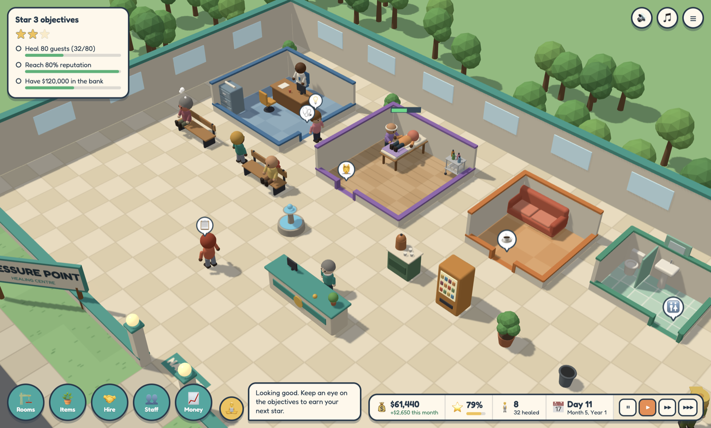

# Pressure Point Institute

A healing-center management sim for macOS and Windows, in the spirit of the classic hospital tycoon games. Build rooms, hire staff, and untie the public.

The MVP covers **massage therapy**. Acupuncture and reiki are planned.



## Play

```bash
yarn install
yarn dev        # in the browser at http://localhost:5183
yarn app        # as a desktop app (builds, then opens Electron)
```

Package installers into `release/`:

```bash
yarn dist:mac   # .dmg for Apple silicon and Intel
yarn dist:win   # .exe installer (x64)
```

## Releasing

Pushing a version tag builds the installers on GitHub Actions and publishes them as a GitHub release:

```bash
git tag v0.1.0
git push origin v0.1.0
```

The tag sets the version number in the installers. Running the **Release** workflow by hand from the Actions tab builds the installers as downloadable artifacts without publishing a release.

Everything runs on GitHub-hosted machines, which are free for a public repository: `macos-latest` for the macOS `.dmg` files (Apple silicon and Intel), `windows-latest` for the Windows `.exe` installer, and `ubuntu-latest` for publishing and for CI on pushes and pull requests.

### Optional: build macOS on the Mac mini

Set the repository variable `MAC_RUNNER` to move the macOS build onto the self-hosted Mac mini, and delete it to go back:

```bash
gh variable set MAC_RUNNER --body self-hosted
```

Self-hosted runners on a personal account belong to one repository, so the Mac mini first needs a runner registered for this repo alongside its existing ones. On the Mac mini:

```bash
mkdir ~/actions-runner-pressure-point && cd ~/actions-runner-pressure-point
VERSION=$(gh api repos/actions/runner/releases/latest --jq .tag_name | sed 's/^v//')
curl -fsSL -o runner.tar.gz "https://github.com/actions/runner/releases/download/v${VERSION}/actions-runner-osx-arm64-${VERSION}.tar.gz"
tar xzf runner.tar.gz
./config.sh --unattended \
  --url https://github.com/maxcwolf/pressure-point \
  --token "$(gh api -X POST repos/maxcwolf/pressure-point/actions/runners/registration-token --jq .token)" \
  --name mac-arm64-runner-pressure-point --labels pressure-point
./svc.sh install && ./svc.sh start
```

While the variable is set, a release waits for the Mac mini and is not published until its build finishes.

### Signing

With no secrets set, the macOS build is signed ad hoc and the Windows installer is unsigned, so both operating systems warn on first launch. `.github/release-notes.md` tells players how to get past that.

To ship a macOS build that opens without a warning, add the same five secrets the other macOS release pipelines use. The workflow then signs with the Developer ID certificate and notarizes with Apple:

`DEVELOPER_ID_CERT_BASE64`, `DEVELOPER_ID_CERT_PASSWORD`, `NOTARIZE_APPLE_ID`, `NOTARIZE_PASSWORD`, `NOTARIZE_TEAM_ID`

## How it plays

1. Place a **Reception Desk** and hire a **Receptionist**.
2. Build a **Consultation Room** (drag the floor, click a wall for the door, place the furniture) and hire a **Wellness Consultant**.
3. Build a **Massage Suite** and hire a **Massage Therapist**. The center opens once all three exist.
4. Guests check in, get diagnosed, get treated, and pay. Keep them patient with benches, tea, snacks, plants and a restroom.
5. Staff members get tired. A **Staff Room** lets them recover; a **Janitor** clears litter, waters plants, and keeps the massage stones hot.
6. Salaries come out at the end of each month. Hit the objectives to earn stars.
7. Stars unlock new **massage modalities**. Build a **Training Room** and send therapists on courses to deliver them.

### Massage modalities

A diagnosis prescribes a modality. It only works properly with a therapist qualified in it and, for some, equipment in the same Massage Suite. An unqualified therapist will still try, at about a third of the usual success rate.

| Modality | Unlocks | Needs | Character |
| --- | --- | --- | --- |
| Swedish | Start | Nothing | Quick, cheap, reliable |
| Deep Tissue | Star 1 | Course | Tires the therapist fast |
| Sports | Star 1 | Course, Stretch Rack | Long and hard to get right |
| Hot Stone | Star 2 | Course, Stone Warmer | High fee; the warmer cools with use |
| Cranio-sacral | Star 2 | Course | Slow, expensive, needs high skill |

The **Massage** menu shows what each modality treats and whether you can deliver it. Any member of staff can also take a skill course.

| Input | Action |
| --- | --- |
| Left click | Select, place, confirm |
| Drag, or W A S D | Move the camera |
| Scroll | Zoom |
| R | Rotate furniture |
| Esc / right click | Cancel |
| Space, 1 2 3 | Pause, game speed |

The game autosaves to local storage every few seconds.

## Code map

| Path | What lives there |
| --- | --- |
| `src/data.ts` | All tunable content: rooms, items, staff roles, traits, conditions, objectives, flavour text |
| `src/state.ts` | The game state (plain JSON) plus save and load |
| `src/world.ts` | Tile grid, placement rules, pathfinding |
| `src/sim.ts` | Guests, staff, lines, money, reputation |
| `src/tools.ts` | Build tools: room drag, doors, furniture placement |
| `src/render/` | Three.js scene and the procedural models |
| `src/ui/` | The HTML heads-up display |
| `src/audio.ts` | Synthesised sound effects and music |
| `electron/main.cjs` | Desktop shell |

Modalities, conditions, courses and equipment are all defined in `data.ts`. Every condition currently routes to the Massage Suite; adding acupuncture or reiki means a new room, its items and a staff role, a model per item in `render/models.ts`, and a treatment room on each modality so the sim knows where to send guests.
