<p align="center">
  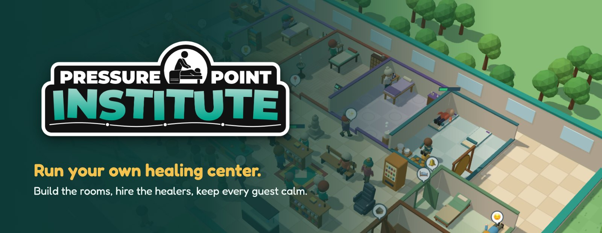
</p>

<p align="center">
  <a href="https://maxcwolf.github.io/pressure-point/"><b>▶ Play in your browser</b></a>
  &nbsp;·&nbsp;
  <a href="https://github.com/maxcwolf/pressure-point/releases/latest"><b>Download for Mac or Windows</b></a>
  &nbsp;·&nbsp;
  <a href="docs/guide.md">Player's guide</a>
  &nbsp;·&nbsp;
  <a href="#build-it-yourself">Build it yourself</a>
</p>

---

**Pressure Point Institute is a healing-center management sim, in the spirit of the classic hospital tycoon games.** Lay out treatment rooms, hire therapists, and send them on courses. Then keep a waiting room full of people with Text Neck, Stagnant Vibes and Gull Shock patient long enough to be seen. Massage, acupuncture, reiki, sound healing and a Shaman are all open for business, and the Qi Gong classes run every week. It runs in your browser with nothing to install, or as a desktop app for macOS and Windows.

<p align="center">
  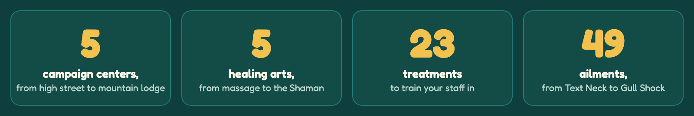
</p>

## Run the place

<p align="center">
  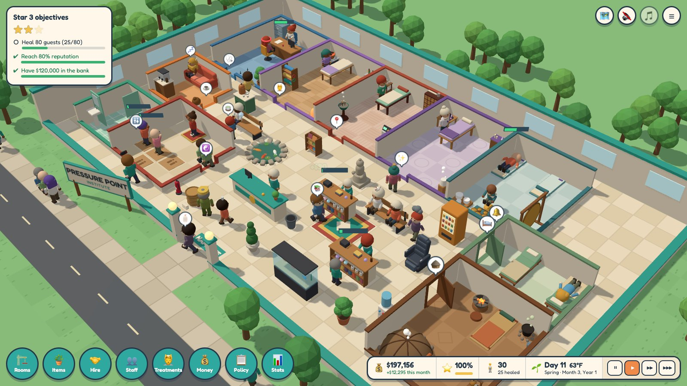
</p>

Drag out a room, click a wall for its door, and furnish it. Hire from the applicants who turn up, and watch your center fill. Every guest has something wrong with them and a limited supply of patience.

<p align="center">
  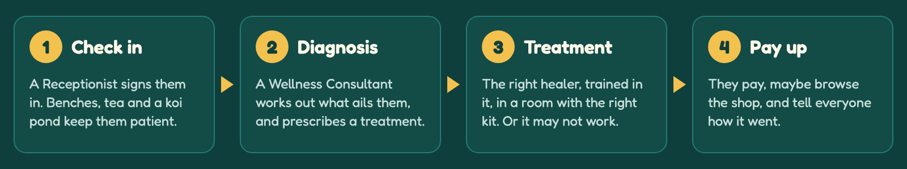
</p>

- **Look after the guests.** Benches, tea, snacks, plants and a restroom keep them patient while they wait. Their condition worsens the longer they wait, and the worse it gets, the less likely their treatment is to work.
- **Look after the staff.** They tire, get thirsty and hungry, and need a Staff Room to recover in. They gain experience, rise through five ranks and expect a raise to match, and quit if you ignore them for too long.
- **Keep it running.** Equipment wears out and breaks down unless a Caretaker services it. Noise spoils treatments nearby, winters get cold and summers hot, and a failed treatment leaves bad vibes over its room.
- **Keep the books.** Set prices, take out loans, run marketing campaigns, and send staff out on house calls. A health inspector and the odd VIP come to judge, and a ZenMart opens across the street to compete for your guests.

## The healing arts

**Massage** is the heart of every center: Swedish to start with, then Deep Tissue, Sports, Hot Stone and Cranio-sacral as you earn stars and train your therapists.

<p align="center">
  
</p>

**Acupuncture** opens at the first star, with its own clinic, its own specialists and a new kind of guest, from Blocked Qi to Pins and Needles. Train up to Cupping, Moxibustion and Electroacupuncture.

<p align="center">
  
</p>

**Reiki** opens at the second star. A Reiki Practitioner clears bad vibes as well as treating guests, with Crystal Reiki, Distance Reiki and Chakra Balancing to learn.

<p align="center">
  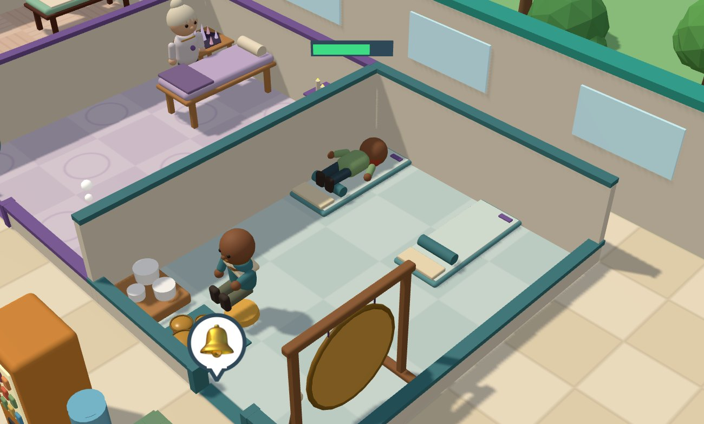
</p>

**Sound healing** treats a whole room at once. Guests lie on the studio's mats and a Sound Healer plays for them all. A Gong Bath carries to the rooms nearby, so build the studio with care.

<p align="center">
  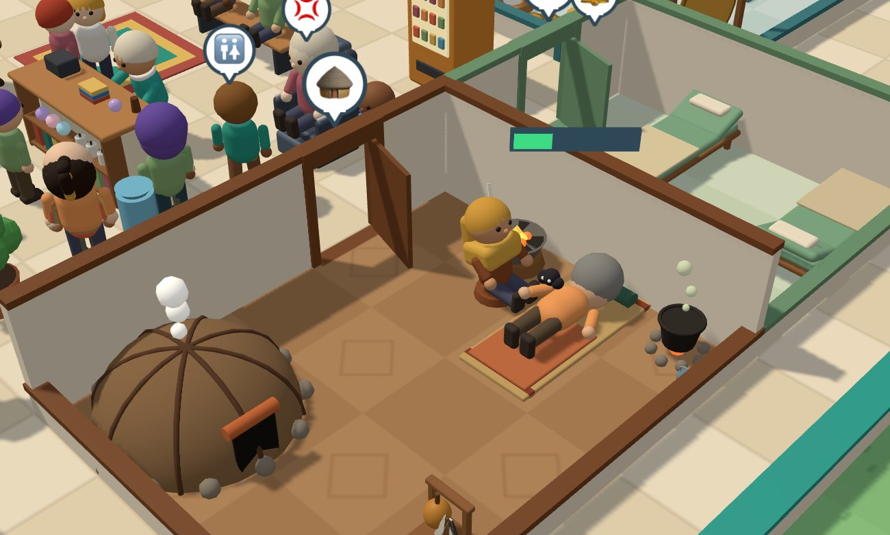
</p>

**The Shaman** opens at The Orchard Estate and in the sandbox, and works in a Ceremony Lodge, one guest at a time: guests with a Lost Spirit Animal, Toxic Ex Energy, or a possession by a chicken, a goat or Brent. There are five techniques, from a Spirit Animal Reading (everyone is an otter) and Spiritual Extraction to the Sweat Lodge and two psychedelic ceremonies. The ceremonies depend on **set and setting**: hold one in a noisy, grubby or gloomy lodge and it may be a bad trip. Between guests, a Shaman clears bad vibes, blesses rooms, and retrieves the souls of burnt-out staff.

<p align="center">
  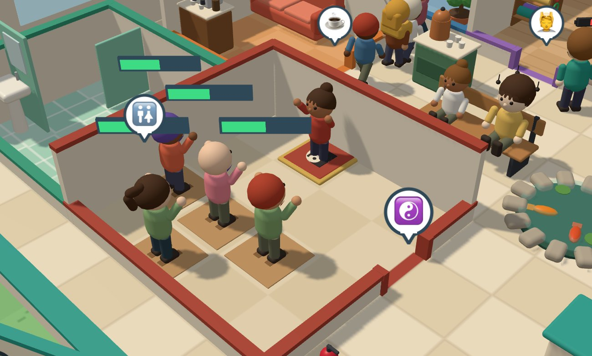
</p>

From the second star, **Qi Gong classes** run on a weekly timetable. Pick the days, add Practice Spots, and class-goers book a place and come in just for the class.

The harder treatments leave a guest needing a lie-down in a **Recovery Lounge** before they head home. Every art but massage, and the Qi Gong classes, can be switched off in **Settings** if you'd rather keep things simple. Every treatment, and what it needs, is in the [player's guide](docs/guide.md#treatments).

## Two ways to play

<p align="center">
  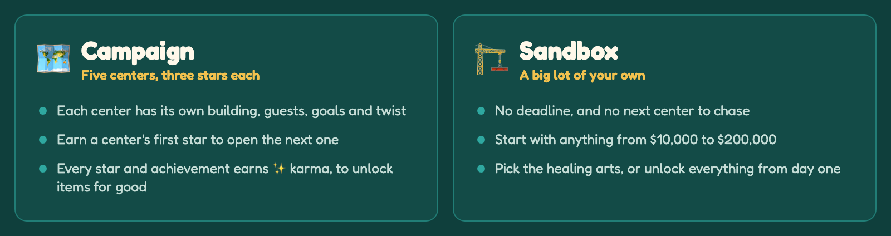
</p>

New to it? Start the campaign at **Willow Lane**: one massage suite and a few regulars, the place to learn the ropes. Each center after it brings a new building, new ailments and a new twist, from rush hours downtown to snowed-in winters in the mountains.

## The campaign

<p align="center">
  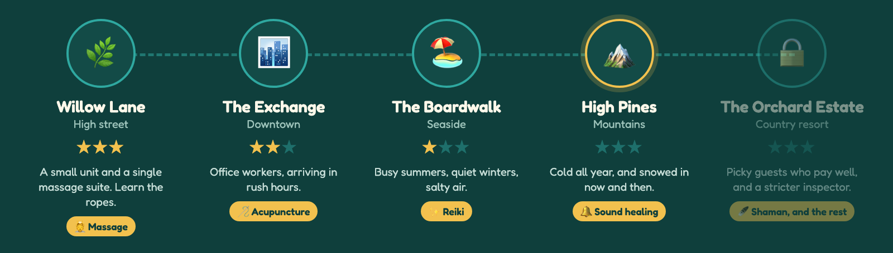
</p>

Five centers, each with its own building, guests, goals and quirks, and three stars to earn at each. A center's **first star opens the next**, and you can always go back for the other two. Each new center brings a healing art with it, until The Orchard Estate, where the Shaman joins the rest and the guests are at their pickiest. Every center is described in the [player's guide](docs/guide.md#campaign-and-sandbox).

### Karma: unlocks that stay unlocked

<p align="center">
  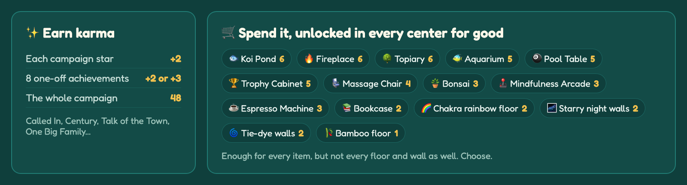
</p>

Every star and achievement earns **✨ karma**. Spend it in the karma shop on items you can't get any other way, or to unlock one before its star comes round. Whatever you buy stays unlocked in every center and the sandbox.

## How you progress

Whether in the campaign or the sandbox, four things grow as you play.

<p align="center">
  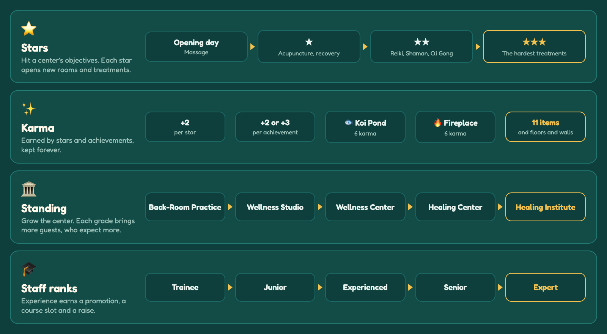
</p>

- **Stars** are earned center by center. Each one opens new rooms, treatments and items, and a level of equipment upgrade.
- **Karma** is for keeps. Spend it on items you can't get any other way, and on floors and walls to decorate with, in every center from then on.
- **Standing** rises as you build finer rooms and take on staff. Each grade brings more guests and better applicants, and guests who expect more.
- **Staff** rise through five ranks as they work. Each rank adds a course they can take, and a promotion comes with a raise.

## What you get

- **A campaign of five centers**, three stars each, plus a sandbox.
- **A healing art for every taste**, each with its own room, staff, treatments and ailments you can spot on the guests who have them, and weekly Qi Gong classes.
- **Staff with careers:** ranks, traits, courses, raises, breaks, and duties you can set.
- **Rooms you can change:** resize them, move them, copy them, save them as templates, and decorate them.
- **Events to plan for:** emergencies, stress outbreaks, VIPs, the health inspector, mishaps like power cuts and storms, staff challenges and a year-end awards ceremony.
- **Overlays and stats:** color the floor by how pleasant, quiet or warm each spot is, or by guests' patience and staff energy, and read the reviews and a casebook of every visit.
- **Sound and music**, with an announcer, and autosave.

## Download

**[Play in your browser](https://maxcwolf.github.io/pressure-point/)**: nothing to install, always the latest version.

Or get the desktop app from the [latest release](https://github.com/maxcwolf/pressure-point/releases/latest):

- `mac-arm64.dmg` for Macs with Apple silicon (M1 and later)
- `mac-x64.dmg` for Intel Macs
- `win-x64.exe` for Windows

The apps are not signed yet, so your computer will ask before opening one the first time. On macOS, right-click the app and choose **Open**. On Windows, click **More info**, then **Run anyway**.

The game saves itself every few seconds. The browser and the desktop app keep their own saves, and **Save or load**, in the pause menu, can export a game to a file and import it into the other.

See the [changelog](CHANGELOG.md) for what's new.

## Build it yourself

The game is TypeScript, with Three.js for the 3D scene, Preact for the interface and Electron for the desktop app. You'll need Node and Yarn (`corepack enable`).

```sh
yarn install
yarn dev   # play it at http://localhost:5183
yarn app   # or as a desktop app
```

- **[docs/development.md](docs/development.md):** running, testing and building the game, and where the code lives.
- **[docs/architecture.md](docs/architecture.md):** how the pieces fit together.
- **[docs/releasing.md](docs/releasing.md):** publishing a release.

## License

[MIT](LICENSE)
